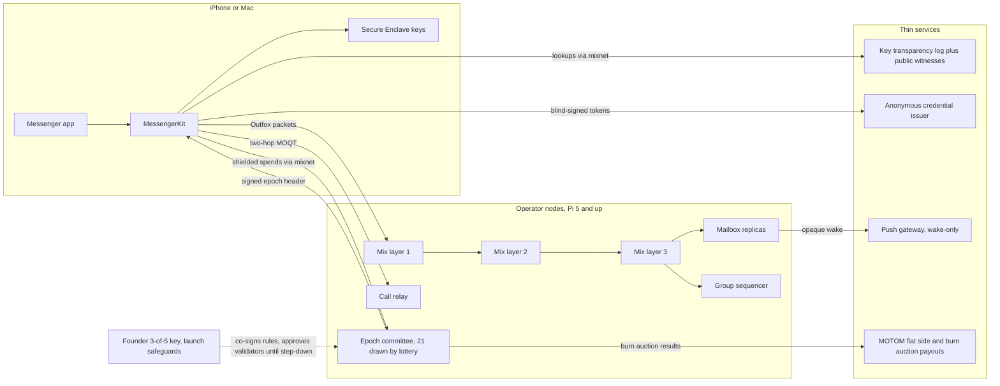
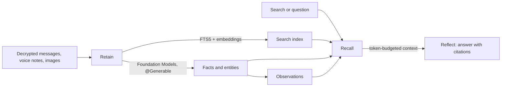

# khensu.nu: decentralized, post-quantum Signal replacement on MOQOM

## Contents

- [Goals and non-negotiables](#goals-and-non-negotiables)
- [Why it's better than Signal](#why-its-better-than-signal)
- [Telegram's features, end-to-end encrypted](#telegrams-features-end-to-end-encrypted)
- [What exists and what has to change](#what-exists-and-what-has-to-change)
- [Architecture](#architecture)
- [Consensus: our own lightweight post-quantum chain](#consensus-our-own-lightweight-post-quantum-chain)
- [Governance and founder safeguards](#governance-and-founder-safeguards)
- [Identity, addresses and handles](#identity-addresses-and-handles-decided)
- [On-device biometrics (Face ID, Touch ID)](#on-device-biometrics-face-id-touch-id)
- [App design](#app-design-decided)
- [Local search and memory](#local-search-and-memory-a-hindsight-style-engine-on-the-device-ios-26-macos-26)
- [Push notifications](#push-notifications)
- [Typing indicators and presence](#typing-indicators-and-presence)
- [Offline use and reliable delivery](#offline-use-and-reliable-delivery-decided)
- [Stealth](#stealth-decided)
- [Public square](#public-square-day-one)
- [webE](#webe-day-one)
- [Places](#places-proposed)
- [Portal project and hardware](#portal-project-and-hardware-proposed)
- [nu-media](#nu-media-proposed)
- [Apple platform features](#apple-platform-features)
- [Mix packet format: Outfox, extended](#mix-packet-format-outfox-extended-decided)
- [Cryptographic design](#cryptographic-design-the-parts-that-must-be-right)
- [Node software, hardware and schedules](#node-software-hardware-and-schedules)
- [Money](#money)
- [Shielded payments over the mixnet](#shielded-payments-over-the-mixnet-decided)
- [Compared with existing post-quantum coins](#compared-with-existing-post-quantum-coins)
- [Launch readiness](#launch-readiness)
  - [1. Encryption export compliance](#1-encryption-export-compliance)
  - [2. Legal entities and documents](#2-legal-entities-and-documents)
  - [3. Trust and safety without reading messages](#3-trust-and-safety-without-reading-messages)
  - [4. Network bootstrap and minimum anonymity](#4-network-bootstrap-and-minimum-anonymity)
  - [5. Battery and data budget](#5-battery-and-data-budget)
  - [6. Contact discovery, invites and growth](#6-contact-discovery-invites-and-growth)
  - [7. Pricing and token numbers](#7-pricing-and-token-numbers-starting-proposal)
  - [8. Operations without telemetry](#8-operations-without-telemetry)
  - [9. Platforms](#9-platforms)
  - [10. Team, budget and timeline](#10-team-budget-and-timeline)
- [Repository layout](#repository-layout-decided)
- [Documentation and patent assessments](#documentation-and-patent-assessments-decided)
- [Milestones](#milestones)
- [Decisions](#decisions)

## Goals and non-negotiables

- Every byte a user creates is end-to-end encrypted: messages, attachments, calls, profile names and avatars, group names, read receipts, typing indicators and backups. No server, node, validator or you ever holds a key that decrypts them.
- Metadata is protected, not just content. No single node, and not you, learns who talks to whom, when, or how often (every message, receipt and typing event goes through the post-quantum mixnet, with no faster path; calls use two-hop relays).
- Post-quantum from day one, for confidentiality, authentication and consensus. Key exchange is pure ML-KEM-1024 (FIPS 203, the highest security category), with no classical algorithm; signatures everywhere, including the consensus, are ML-DSA-87 (FIPS 204).
- Decentralized at launch: independent operators run the nodes, the node list is agreed by a rotating committee drawn from those nodes, and the user directory is an append-only transparency log anyone can audit. Founder safeguards protect the network from capture until it is established.
- Light enough to run a node on a Raspberry Pi 5.
- iPhone, iPad and Mac first, in the `khensu-*` repos, reusing MoqomKit (calls and transport, with khensu's stealth profile added in khensu repos; direct paths only on local links) and moqom-security's device-key proof and token designs; MLS comes from an OpenMLS fork in `khensu-core`.

## Why it's better than Signal

Signal is the bar, and on content encryption it is very good: the Double Ratchet, PQXDH (hybrid X25519 + ML-KEM for the first key agreement), SPQR (post-quantum added to the ongoing ratchet), sealed sender, and zero-knowledge group credentials that keep group membership hidden from its servers, all with published formal analyses. The advantages below are specific; each one is a requirement this plan must meet, not marketing.

1. **Post-quantum authentication, not just post-quantum secrecy.** Signal's identity keys and signatures are Curve25519/XEdDSA, which are classical. A future quantum computer could not read recorded Signal messages, but it could impersonate a contact or forge identity keys. Here every identity key, device credential, KeyPackage, commit, message signature and consensus vote is ML-DSA-87, so impersonation is quantum-resistant too.
2. **The network hides who talks to whom; Signal's server sees much of it.** Sealed sender hides the sender of a message from Signal, but Signal still sees the recipient, the sender's IP address, and exact timing. Published research (Martiny et al., NDSS 2021) shows that over time those let a server link senders to recipients anyway. Here messages go through a three-layer mixnet with random delays and constant cover traffic, using a post-quantum packet format (Outfox with ML-KEM), mailboxes are unlinkable and rotate every epoch, and no node, validator, or you sees sender, recipient and timing together.
3. **No single operator to compel, breach, block or shut down.** Signal runs every server, so one legal order, one breach, one funding crisis, or one national firewall rule (Signal has been blocked in Iran, China, Russia and elsewhere) affects everyone. Here independent operators in many countries run the nodes, a different randomly drawn committee agrees the node list each epoch, and blocking means blocking thousands of changing node addresses, many of them on home connections.
4. **No phone number, ever.** Signal still requires a phone number to register, even with usernames hiding it from contacts, so your carrier and Signal can link the account to a SIM. Here identity is a key in the Secure Enclave plus an optional username. Phone and email lookup are optional and come only with private contact discovery.
5. **No trust in Intel hardware enclaves.** Signal's contact discovery and PIN-based key backup (Secure Value Recovery) rely on Intel SGX and similar enclaves, and SGX has a history of side-channel breaks. Here there is no contact discovery server to trust, and backups are encrypted with a recovery key only the user holds.
6. **Key verification that works for every contact, with more witnesses and private lookups.** Signal shipped key transparency as "Automatic Key Verification" in 2026 (on for all users since Android 8.21.6, iOS 8.22.0 and Desktop 8.21.0; [Signal blog, 11 Aug 2026](https://signal.org/blog/automatic-key-verification/)). Its limits, from Signal's own documentation: it works only when you have the contact's phone number, so username-only contacts (the most privacy-conscious users) fall back to comparing safety numbers by hand; it relies on two hand-picked auditors (Cloudflare and Trail of Bits); and clients accept auditor signatures up to seven days old, so a malicious server could keep a split view for up to a week ([Trail of Bits, 11 Aug 2026](https://blog.trailofbits.com/2026/08/11/how-trail-of-bits-helps-verify-the-integrity-of-your-signal-chats/)). Here identity is a key, not a phone number, so every contact is verified automatically; the log is cosigned by a quorum from the public transparency-dev and Sigsum witness networks; entries are signed with ML-DSA-87; clients require cosignatures no older than 24 hours; and lookups go through the mixnet, so the log never learns whose key you checked.
7. **Calls that hide IPs from everyone, not just the other person.** Signal's "always relay calls" hides your IP from the person you call, but Signal's relay sees both IPs. Here every call goes through two relays run by different operators, so no single machine sees both ends, with constant-bitrate padded media, call setup over the mixnet and no direct internet paths, so calls leak neither speech patterns nor IP addresses.
8. **Group security that heals.** Signal groups use sender keys, which rotate only when membership changes, so a key stolen from one phone keeps decrypting that sender's group messages until then. MLS here has every device refresh its key every 24 hours or 1,000 messages, so a group recovers from a compromised device automatically. Group membership is hidden from the network: the sequencer sees only an opaque group ID and encrypted commits that arrive over the mixnet.
9. **Encrypted at rest by the Secure Enclave on every platform.** The local message store key is wrapped by the Secure Enclave on iPhone and Mac, not kept in a config file, which is a mistake Signal Desktop made until 2024.

Where Signal is equal or still ahead, stated in the threat model so the claims stay honest:
- **Parity:** content encryption strength, formal verification, push notifications that carry no content.
- **Signal ahead:** a decade of audits and real-world testing, a huge user base, Android, Windows and Linux clients at launch, and a nonprofit trusted by journalists.
- **Costs of the mixnet:** messages arrive in seconds rather than milliseconds, and cover traffic uses more battery and data. Live calls can't use the mixnet, so a global observer could still correlate call timing; calls are protected against single nodes, not against a global adversary.
- **Launch trust:** until the founder steps down, users trust the founder not to approve malicious validators. That is trust about routing integrity, never about message content.

## Telegram's features, end-to-end encrypted

Telegram's appeal is its features, not its security: ordinary chats and all groups are "cloud chats" Telegram can read, and only 1:1 Secret Chats on a single device are end-to-end encrypted ([Telegram FAQ](https://telegram.org/faq)). Its E2EE group calls (up to 200 people) are the exception. The goal is every Telegram feature with nothing readable by us or any node.

| Telegram feature | How we build it, encrypted |
| --- | --- |
| Instant sync on every device, full history on a new device | MLS multi-device; history copied encrypted from an existing device when linking, or restored from an encrypted backup on mailbox nodes |
| Groups up to 200,000 | Encrypted groups up to 1,000 devices with TreeKEM, which is the cap (decided: no larger groups); anything bigger is a channel |
| Channels with unlimited subscribers | MOQOM broadcasts: public channels are public content served by relays; private channels encrypt each post and seal keys to subscribers with MOQOM's audience envelopes (keys rotate every 5 minutes) |
| Channel comments, reactions, view counts | Comments as a linked encrypted group; reactions as encrypted messages; view counts approximated with anonymous tokens so nobody learns who viewed |
| Topics / forums in groups | Threads inside one MLS group, carried in the encrypted message metadata |
| Group voice chats, video calls, live streams | MOQOM's core: rooms and broadcasts with thousands of viewers at sub-second latency, end-to-end encrypted, recording only by an agent every member can see (beyond Telegram's 200-person E2EE calls) |
| Secret chat self-destruct | Disappearing messages in every chat, with a per-chat timer |
| Edit, delete for everyone, pin, reply, forward, polls, quizzes, scheduled messages | Encrypted control messages; poll results counted on devices; scheduled messages held sealed by mailbox nodes until the send time |
| Saved Messages, chat folders, archive, multiple accounts | Note-to-self MLS group; folders and archive synced encrypted between your devices; multiple personas per app |
| Cloud search | On-device full-text search over the encrypted local store; public channel discovery through an opt-in public directory |
| Usernames and t.me links | Permanent `@handles`, links and QR codes, ENS subnames; handles can't be traded (unlike Telegram's username marketplace) |
| Files up to 2 GB (4 GB Premium) | Chunked, encrypted attachments on mailbox nodes; the size limit is set by storage cost (2 GB free, larger with a subscription) |
| Stickers, GIFs, emoji | Sticker packs as public, content-addressed files; GIF search goes through the mixnet so providers don't see who searched |
| Voice and round video messages, transcription, translation | Transcription and translation on the device (Apple Speech and Translation frameworks), never on a server |
| Stories | Encrypted to the chosen audience with audience envelopes, expiring |
| Live location | End-to-end encrypted, building on MOQOM's live map work ([live-map guide](sites/moqom-dev/src/content/docs/guides/live-map.md)) |
| Bots | Bots join as visible members of the encrypted group, like MOQOM agents; they only see chats they were added to, and every member sees that they're there (Telegram bots read through Telegram's servers) |
| Mini Apps | Sandboxed web apps with no access to keys, opened by user action, talking to the chat only through a narrow, permissioned API |
| Payments, Stars, tips, gifts | MOTOM credits and creator tips (already built), opt-in stablecoin payments to linked wallets; Apple's in-app purchase rules for digital goods |
| Admin tools: roles, slow mode, bans, anti-spam | Roles and permissions are signed into the encrypted group state (MOQOM's capability model); every member's app enforces them; spam handled by message requests, rate-limit tokens, and verifiable abuse reports (message franking, which lets a recipient prove what an abusive message said without breaking encryption for anyone else) |
| Web version | Desktop apps first; a web client is hard to secure for E2EE because the server delivers the code each time |

Beyond Telegram: everything above is end-to-end encrypted and post-quantum by default, metadata is hidden by the mixnet, no phone number is needed, wallet and ENS links, creator tipping in live rooms, AR spaces from MOQOM ([ar-space guide](sites/moqom-dev/src/content/docs/guides/ar-space.md)), on-device AI summaries, and anyone can earn by running a node.

What we won't copy: sponsored messages in channels, server-side access to chats, and tradeable usernames.

## What exists and what has to change

Reusable today:
- PQ MLS in Swift/Go/Rust with cross-language vectors: [moqom-security/docs/moqom-mls.md](moqom-security/docs/moqom-mls.md) (suite `0xF0AA` ML-KEM-768 + ML-DSA-65, plus X-Wing `0xF0A1`).
- Device keys in the Secure Enclave and proof of possession: [moqom-security/docs/moqom-proof.md](moqom-security/docs/moqom-proof.md), `MoqomKit/Security/DeviceKey.swift`.
- 1:1 and small-room calls, direct paths, fallback, GOAWAY-style relay migration: `moqom-swift-pq/Sources/MoqomKit/Direct/`, [peer-to-peer guide](sites/moqom-dev/src/content/docs/guides/peer-to-peer.md).
- Record format for app-data tracks: [moqom-pq/docs/data-format.md](moqom-pq/docs/data-format.md).
- Fiat money layer (Stripe purchases for MOQOM Cloud customers, burn auction seller payouts): [motom/docs/README.md](motom/docs/README.md).

Gaps that block "solid everywhere" (from [moqom-pq/docs/E2EE-KEY-MANAGEMENT.md](moqom-pq/docs/E2EE-KEY-MANAGEMENT.md) "Not done" and the MLS subset list), and how each is closed:

**MLS implementation base (decided).** `khensu-core` forks OpenMLS (Rust, MIT), which already implements RFC 9420 in full and passes the MLS working group's vectors, and adds `MLS_256_MLKEM1024_AES256GCM_SHA512_MLDSA87` through a libcrux crypto provider (formally verified ML-KEM and ML-DSA). One MLS implementation serves the app (through UniFFI) and the node. moqom-security's Swift and Go MLS stay with MOQOM Cloud; khensu doesn't depend on them. Our fork stays close to upstream so security fixes merge cleanly, and the suite provider is offered upstream.

1. **No `PrivateMessage` or secret tree, so no forward secrecy inside an epoch.** Closed by OpenMLS's RFC 9420 secret tree and `PrivateMessage`: a separate ratchet per sender, a fresh key per message, each key deleted after use. Because the mixnet reorders and delays, receivers keep skipped keys for at most 1,000 generations per sender and 7 days, then delete them. Messages from up to 3 earlier epochs are accepted within the same 7 days, so a commit doesn't strand messages already in flight. Passes the `secret-tree` and `message-protection` vectors.
2. **No per-sender signatures on application data.** Closed in messaging by MLS's own framing: every message is signed with the sender's ML-DSA-87 leaf key inside the ciphertext, with rotating keys and delayed reveal (see Cryptographic design). Calls carry media in SFrame, and SFrame keys derived from the group are shared, so in group calls any member could otherwise fake another member's frames. Group calls therefore add a signed manifest: each sender signs a hash of its recent frames' authentication tags with its leaf key, once per second for video and every 5 seconds for audio only (about 37 kbit/s or 7.4 kbit/s of overhead). Receivers play frames immediately, check each manifest when it arrives, and drop and flag a sender whose manifest fails. One-to-one calls need no manifest, because only the two devices on the call hold the keys.
3. **Basic credentials only (`username/device`).** Replaced by a khensu credential type: the account address, a device index, the device's ML-DSA-87 signature key, and a pointer to the transparency log entry where an identity device signed that key. Members check the log entry, its inclusion proof and a quorum of witness cosignatures when a device joins and at every epoch change. A device revoked in the log is removed from each group by the next commit any member makes. Groups reject basic credentials.
4. **Flat member list with linear commits.** Replaced by OpenMLS's ratchet tree (TreeKEM), passing `tree-math`, `tree-validation`, `treekem`, `secret-tree` and `message-protection`, with groups capped at 1,000 devices. Sizes with ML-KEM-1024 and ML-DSA-87:
   - A commit carrying a full update path in a 1,000-device group is about 45 KB, so it fits one bulk packet.
   - Each leaf is about 9 KB, because the credential points into the log rather than embedding the identity key and its signature. The full tree is about 520 KB for a 50-device group and about 10.5 MB at 1,000 devices.
   - Welcome messages leave the tree out (RFC 9420 allows this). New members fetch it as content-addressed, padded chunks from mailbox nodes over the bulk lane and check it against the group's tree hash. Joining a 1,000-device group takes a few minutes on cellular; most groups are far smaller.
5. **The delivery service is room-scoped and ephemeral.** Replaced by persistent, ordered delivery with no central server:
   - Group state lives on members' devices. Nothing is dropped when nobody is online.
   - Commits are ordered by the group's sequencer (architecture below). It returns a signed receipt for each accepted commit (group, epoch, hash), and two receipts for the same epoch are proof that the sequencer misbehaved. Sequencer duty passes to the standby at epoch boundaries, along with the latest receipt.
   - Application messages need no global order: MLS orders them by epoch and generation, and the app sorts by the sender's timestamp inside the ciphertext.
   - Every packet for a device waits on three mailbox replicas, run by different operators, until the device fetches it: up to 30 days on Free and 90 days on Plus. A device away longer rejoins its groups by external commit, signed by one of its identity devices.
   - The 10-minute prune and the "group dropped when empty" behaviour go away.
6. **`moqom-relay` is proprietary** ([moqom-engine-pq/LICENSING.md](moqom-engine-pq/LICENSING.md)). The node is `tatenan` in `khensu-tatenan`: a new open binary built on the Apache crates (`moqom-proto`, `moqom-transport`, `moqom-client`) that never links the relay. Its call-relay role reimplements forwarding from the MoQ transport spec. Before the code goes public, a licence check confirms nothing from the proprietary relay was copied.

**Licensing (decided).** The node, the chain node, the services and the apps are AGPL-3.0, as Signal's server and apps are, so a modified node or app has to publish its changes and nobody can run a closed fork of the network. The protocol libraries in `khensu-core` (the MLS suite and provider, Outfox, credentials, the consensus wire format, test vectors) are Apache-2.0, so independent implementations can exist. The specs are CC BY 4.0. Outside contributors sign a CLA through a CLA bot on every repo, which keeps you able to publish the iOS build under a separate grant (Apple's terms conflict with AGPL) and to sell commercial licences.

## Architecture

Roles and trust:
- **Mix nodes** (Loopix-style, three layers, fixed-size Outfox packets using ML-KEM, Poisson delays, cover traffic from clients and nodes). They see only the previous and next hop. Standard Sphinx uses classical X25519, so it is not used.
- **Mailbox nodes** hold sealed packets per device under unlinkable mailbox IDs, replicated across at least three operators in different networks. They cannot read or attribute anything.
- **Group sequencers** order MLS commits per group: first commit per epoch wins, as the current delivery service does. The sequencer is chosen deterministically from the group ID over the epoch's node list and has a standby. It can delay or drop (detected and failed over) but cannot forge, since members verify signatures and confirmation tags. A sequencer that signs two different commits for the same group epoch is provably misbehaving and penalized. It sees only an opaque group ID and encrypted commits that arrive over the mixnet, so it never learns who is in a group.
- **Call relays** carry MOQT media under the stealth call profile (see Stealth). A call uses two relays (caller's entry and callee's entry) so no single node sees both IPs. There are no direct internet paths; direct links exist only on Wi-Fi Aware or a shared Wi-Fi network.
- **Epoch committee** (see Consensus below) agrees and signs each epoch's header. It never sees user traffic.
- **Key transparency log** maps usernames to identity keys and device lists. It is append-only and publishes checkpoints in the C2SP `tlog-checkpoint` format, cosigned (`tlog-cosignature`) by the existing transparency-dev and Sigsum witness networks, so independent witnesses exist from day one without recruiting. Clients require a quorum of witness cosignatures and verify inclusion and consistency proofs, so even the log operator cannot show different keys to different people.
- **Credential issuer** blind-signs anonymous access tokens after payment. Nodes check that a token is valid without learning who bought it.
- **Push gateway** (`push.khensu.nu`): the one unavoidable central piece, because APNs is tied to your developer key. It receives only an encrypted wake capability and sends a content-free "New message" alert. It never learns the sender, the conversation or the user's address. See Push notifications below.

## Consensus: our own lightweight post-quantum chain

Nodes relay and replicate data. Consensus agrees on these things per epoch (one hour). Only token balances and stakes persist; everything else is dropped after the dispute window:

1. The node list root: who is in, with which roles and leases.
2. The reliability scores root, from measurement.
3. The work receipts root, for paying operators.
4. Evidence of provable misbehaviour (conflicting leases, a sequencer signing two commits for one epoch, persistently failed measurement).
5. The account state root (token balances and stakes) and the shielded pool's note commitment root for the current eras.

Design:
- **Sortition.** Every eligible node is in a weighted lottery each epoch, and about 21 are drawn to form that epoch's committee. Eligible means a lease covering the whole epoch, enough reputation, and good measured reliability. A Pi 5 on an always-on or scheduled lease qualifies; idle-time machines do not. The draw uses randomness from the previous epoch's header and caps how many seats any one operator, network provider (autonomous system) or country can hold.
- **BFT agreement.** The committee runs a HotStuff-family protocol and produces one epoch header signed by at least 2/3 of its members with ML-DSA-87. The consensus is post-quantum, which Ethereum and most chains are not.
- **Light nodes and clients.** Everyone else checks about 14 ML-DSA signatures per epoch and keeps only the current node list (a few hundred KB for 10,000 nodes). The full list is fetched from any node or mirror and checked against the header's root, so mirrors are untrusted.
- **State, not history.** Validators keep the current account state (balances, stakes) and the current shielded eras, plus the last few epochs of blocks for disputes. Older blocks are dropped; a new node syncs from a committee-signed state snapshot. Anyone may archive history; the network does not need it, and shielded transfers reveal nothing even when archived.
- **Measurement.** Loop cover traffic (packets a node routes back to itself) doubles as measurement and looks exactly like real traffic. A random, weighted set of measurers each epoch sign reports; a node's score is the median across measurers; measurers far from consensus lose reputation and bond.
- **Sybil resistance (decided).** Weight is reputation multiplied by staked tokens. Reputation is earned by measured, honest service over weeks, so buying tokens alone can't buy influence, and an attacker loses both reputation and a slice of stake when the consensus records provable misbehaviour. Per-operator, per-network-provider and per-country seat caps still apply.

## Governance and founder safeguards

Rule changes (fees, eligibility, penalties, cipher suites):
- Need both the founder signature and 2/3 of the epoch committee.
- Take effect only after a 30-day timelock, during which the committee can veto.
- Emergency fixes take 48 hours but may only tighten rules (disable a cipher, raise requirements). Nothing that loosens rules or touches money can use the fast path.

Founder key: a 3-of-5 threshold of ML-DSA-87 keys on separate hardware: two offline (air-gapped laptops, backups in separate safes), one in a cloud HSM if it supports ML-DSA (check Google Cloud KMS), and two with trusted people or counsel for recovery. Any 3 shares can revoke and replace the founder key, behind the timelock. The founder key is pinned in the app with the genesis validator keys. Because founder changes also wait the 30-day timelock, a thief with 3 shares still cannot loosen rules or move money before the key is rotated.

Founder powers by stage:
1. **Genesis.** The committee is drawn only from validators you run and partners you approve. Your co-signature is needed for every committee admission and every rule change.
2. **Open candidacy.** Any node with enough reputation enters the lottery; you can veto admissions.
3. **Established.** When objective thresholds hold for 90 days (for example at least 500 nodes, 100 independent operators, 20 countries, 50 network providers and 63 eligible committee candidates), the network shows that the step-down is available, and it takes effect when you sign it with the founder key (decided: manual sign-off). Your admission veto then ends; the dual-approval co-signature on rule changes remains.

What the founder can never do, at any stage: read content, unmask users, skip the timelock except for tighten-only emergencies, or change payouts and penalties without the timelock.

App and supply-chain takeover (a separate, bigger real-world risk): hardware security keys on the Apple developer and GitHub accounts; release signing only from locked-down CI; every app and node release hash published to the transparency log so nodes and outside watchers can see an unexpected release; reproducible builds for the node and the Pi image.

## Identity, addresses and handles (decided)

- **Permanent address.** Each account's address is SHA3-256 of its first identity key and that key's commitment to the next key: 32 bytes, unique by construction, never changes, needs no registry to stay unique. Displayed as bech32m with an app prefix and checksum (`khensu1q8f...`), shared mostly by QR code and link. Users may create several unlinked addresses (personas).
- **Key rotation by pre-rotation (KERI-style).** Every identity key publishes the hash of the next key, which stays offline. Rotating reveals the next key, which must match; a thief holding only the current key cannot rotate the owner out. Each rotation is an entry in the transparency log, batched per epoch.
- **Handles: optional, unique, permanent.** A handle such as `@elliott` is claimed first-come in the log with an anonymous credential and is bound to its address forever: it can never be renamed, transferred or reissued, even after an account is abandoned, so a handle always means the same person. Claiming shows a clear "this can never be changed" confirmation. A short list of reserved words and trademarks, and a dispute policy that can mark a handle "disputed" or stop serving it, but never reassign it.
- **Wallet links for web3.** Opt-in, per wallet, revocable: the user signs a Sign-In with Ethereum (EIP-4361) statement linking a wallet to their address, published in the log, optionally also as an ENS text record. Wallet keys are never reused as messenger keys (they are classical secp256k1). The app warns that a linked wallet's public transaction history becomes associated with the address.
- **Account deletion in the app (App Store guideline 5.1.1(v)).** Settings → Account → Delete account, confirmed with Face ID and by typing the handle. It signs a tombstone into the log (the address and handle are retired forever and never reissued), tells your groups you left, asks mailbox nodes to drop your mailboxes and backups, revokes push capabilities, and wipes keys and data on every linked device. Before that, the app shows any wallet balance and asks you to send it somewhere or confirm forfeiting it. Without the phone, the recovery kit can sign the same tombstone from any new install. Abandoned accounts fade on their own: mailbox leases and backups expire after 90 days without renewal; the handle stays retired.
- **Identity devices, not a copied key.** Secure Enclave keys can't be exported, so the identity is the set of device identity keys listed in the log, not one key that moves. Each phone, iPad or Mac you set up as a primary device generates its own non-exportable identity key, and any one of them can add or remove devices with Face ID. Removing your *other* devices starts a 72-hour window during which every device is alerted and can cancel, unless the removal is signed with the recovery kit. That stops a thief who knows your passcode from locking you out.
- **Switching phones with the old one in hand.** On the new phone, choose "Transfer from my old phone" to show a QR code holding a one-time ML-KEM-1024 public key. The old phone scans it and asks for Face ID. It then adds the new phone's identity key to the log, and sends history, keys for groups, contacts, settings and wallet notes directly to the new phone over Wi-Fi Aware or the local network, encrypted with the agreed secret, never through nodes. The old phone then offers to remove itself and wipe. Groups see a new device, not a new safety number. The same flow links an iPad or Mac, which then also counts as an "old phone" for future transfers.
- **Switching phones when the old one is lost or broken.** Any other linked device (iPad, Mac) can add the new phone as above. With no other device, choose "Restore with recovery kit" and enter the 24-word recovery phrase. It reveals the pre-rotated next key, rotates the identity to the new phone's key, revokes every old device at once, restores the encrypted backup from mailbox nodes if backups were on, and restores wallet notes. Contacts see "Ana restored her account" and a new safety number. Encrypted backups are a Plus feature; without them, contacts and groups come back but older message history doesn't (free users move history with the phone-to-phone transfer).
- **Recovery kit.** Created during sign-up and required before claiming a handle or holding a balance: a 24-word phrase (printable, with a QR) that derives the pre-rotated next key, the backup key and the wallet seed. Optional social recovery splits it 3-of-5 among chosen contacts (Shamir shares sent as ordinary encrypted messages), so three of them together can help you restore. With no device, no phrase and no recovery contacts, the account can't be recovered by anyone, us included; the app says so plainly during setup.
- **No third-party login (App Store guideline 4.8).** Identity is the app's own key-based sign-up, so the guideline's "own account setup and sign-in" exception applies and Sign in with Apple isn't required. Wallet links stay an optional profile feature, never a way to sign in; otherwise 4.8 could apply.
- **Human-friendly layers over the address.** Three layers, all pointing at the permanent address:
  - The `@handle` resolves to the address through the log.
  - The handle's full form is a subname of our own domain: `elliott.khensu.nu`. It is shown on profiles and in share links, and the app resolves it from the key transparency log over the mixnet, never through DNS, so lookups don't leak who is looking up whom.
  - For wallets and dapps outside khensu, `khensu.nu` is imported into ENS as a DNS name (DNSSEC-signed) and served by an off-chain resolver (ERC-3668 CCIP-Read) that answers from our log, with no per-name on-chain fees. The resolver returns log proofs, so it can't lie about which address a handle maps to. No public DNS records or web pages are created per user.
  - A spoken check phrase of four words derived from the address, for confirming a contact out loud. It's for verification only and never used to look anyone up, because four words aren't unique.
- **Anonymous registry.** Registration and lookups go through the mixnet, paid with blind-signed credentials. Log entries are stored under a VRF so the log can't be enumerated or scraped, and handles are stored as VRF outputs with commitments rather than plaintext, so a handle can stop being served (for disputes or erasure requests) without rewriting the append-only log. Profiles are encrypted with a profile key shared only with contacts. Device counts are padded. First contact goes through message requests and costs an anonymous rate-limit token.

## On-device biometrics (Face ID, Touch ID)

Biometrics never leave the device and never reach us; the Secure Enclave matches the face or fingerprint and then releases a key operation. Each key gets its own access policy (`SecAccessControl` with LocalAuthentication):

| Key or action | Policy | Why |
| --- | --- | --- |
| Identity key (rotation, claiming a handle, linking a wallet, linking a new device, approving a removal) | Face ID or Touch ID every time, `.biometryCurrentSet` | The most powerful key. Bound to the currently enrolled biometrics, so adding a new face or finger invalidates it, which defeats someone who learns the passcode and enrolls their own face. Recovery is through the pre-rotated next key |
| Pre-rotated next key | Offline: a recovery kit (printed code or a second device), never on the phone | A stolen or coerced phone can't rotate the account away |
| Backup recovery key export | Face ID or Touch ID plus device passcode | Rare and high-impact |
| App unlock | Face ID or Touch ID, passcode fallback; on by default with a short grace period | Protects an unlocked phone handed to someone else |
| Local store key | Released after app unlock, wiped from memory when the app locks | Message history is unreadable while the app is locked |
| Device (MLS) key for routine messaging and calls | No per-message prompt; available only while the app is unlocked or after first unlock, per the setting below | Prompting for every message is unusable, and receiving needs the key |

Receiving while locked: incoming packets go into a queue file with `NSFileProtectionCompleteUnlessOpen`, which can be written while the phone is locked but read only after unlock, so new messages are stored safely without exposing history. Lock-screen previews need decryption while locked, so they are off by default and the notification says only "New message".

Coercion: a setting can require the passcode instead of Face ID for app unlock, because a face can be forced in a way a passcode can't. iOS's emergency SOS gesture already disables biometrics until the next passcode entry, and the app explains this. Touch ID on Macs (Apple silicon, or a Magic Keyboard with Touch ID) uses the same policies; Android's StrongBox with BiometricPrompt is the equivalent later.

Panic wipe: iOS doesn't let third-party apps read side-button or volume-button press patterns (the Side Button Access entitlement is only for launching voice assistants in Japan). Instead:
- A "Panic" App Intent that the user can put on the Action Button, a Control Center or Lock Screen control, or a Back Tap shortcut. App Intents run on the device; this doesn't involve Siri.
- A duress passcode on the app unlock screen that wipes while appearing to open an empty app.
- An optional wipe after a set number of failed app-unlock attempts.
- The wipe is a crypto-erase: delete the Secure Enclave key that wraps the database key and the identity and device keys, so the encrypted store becomes unreadable at once, then delete the files. Behavior when triggered while the phone is locked (the keychain may refuse deletes) must be tested on devices; the fallback is to lock the app and finish the wipe on the next unlock without showing anything first.

## App design (decided)

- **Native first.** SwiftUI on iOS 26 Liquid Glass components (glass tab bar, toolbars, sheets), one codebase for iPhone, iPad and Mac with a three-column split view on iPad and Mac. Dynamic Type, VoiceOver and Reduce Motion supported from the start.
- **No custom chrome.** Default `NavigationStack` bars with large titles and glass toolbar buttons, the stock `TabView` with a search-role tab, `Menu` for pull-down menus, `.contextMenu` with previews on long press (reactions sit above the menu), `.swipeActions` on chat rows (leading Pin and Read, trailing Mute and Archive) and `.searchable`. The brand shows up only in content: colors, the crescent mark and moon-phase timers.
- **Monochrome, spacey identity.** Khensu is the Egyptian moon god, "the traveller":
  - Monochrome: true-black and graphite surfaces, silver for your bubbles, starlight white for actions, verified badges, unread counts and mentions. Red only for destructive actions and ending calls. Dark and true-black themes first, plus a light theme.
  - Connected-dot node networks, in the style of moqom.cloud's relay web, are the recurring motif: spatial-audio calls show each voice as a lit node on a sphere around you, the lock-screen and empty-state wallpapers are slowly turning dot networks, and the node app shows the live mixnet the same way. Motion respects Reduce Motion.
  - The app icon is a thin white ring with a second, unfilled arc just inside its left half, nearly a half circle of the same size, meeting the ring at top and bottom centre, so it reads as two circles forming a crescent line. The dark tile is the master and the default icon; light, tinted and clear styles derive from it.
  - Moon phases show disappearing-message timers (the moon wanes as a message nears expiry).
  - Typography: SF Pro for the interface, with a display face for the wordmark only.
- **Telegram-like layout.** Chat folders as tabs at the top of the chat list (All, Personal, Groups, Channels, Unread, custom folders); swipe to pin, mute, archive or mark read; replies, reactions, threads, polls, stickers and voice and video notes in the chat view. Bottom tabs: Chats, Feed (the public square and forums on webE), Calls, Search ("Ask khensu"), Settings.
- **Visible but quiet security.** A white check on verified contacts, the four-word check phrase on profiles, and a Face ID unlock screen styled like the lock screen. There's no crypto jargon in the main interface; details live under "Encryption" on each chat.
- **Node app (`nu.khensu.tatenan`).** A macOS menu-bar app in the same palette, showing node status, schedule and earnings.

## Local search and memory: a Hindsight-style engine on the device (iOS 26+, macOS 26+)

Search can't use a server: no node ever holds plaintext. So the device runs its own memory engine modeled on [Hindsight](https://hindsight.vectorize.io/) (MIT-licensed, so its design and extraction prompts can be adapted with attribution). Hindsight itself is Python on Postgres with pgvector, so this is a Swift reimplementation in a new package, `KhensuMemory`, on the app's encrypted SQLite store. Minimum OS is iOS 26 and macOS 26 (Foundation Models' first release); iOS 27 features are used when available.

- **Retain** (on unlock, as messages arrive):
  - Every message goes into an FTS5 full-text index (BM25) immediately. Exact search works on every iOS 26 device, offline, with no AI.
  - Conversation windows are embedded on the device with Apple's `NLContextualEmbedding` (multilingual, no model to ship) and stored as int8 vectors in the same database (sqlite-vec or a small HNSW index).
  - On Apple Intelligence devices, Foundation Models extracts typed facts with `@Generable` structs: plans and dates, decisions, addresses, links, things people asked you, and the entities they mention (people, places, organizations). Each fact links to its source message IDs.
  - Voice notes are transcribed with `SpeechTranscriber` and images get on-device text recognition and labels from Vision (iOS 27's multimodal on-device model adds image descriptions), so both are searchable.
- **Recall** runs four searches in parallel, as Hindsight does: keyword (BM25), semantic (vectors), graph (facts sharing an entity, up to two hops) and temporal ("last spring" parsed into a date window). Results are fused by rank (reciprocal rank fusion), then cut to a token budget rather than a fixed count, which suits the on-device model's 4,096-token context.
- **Observations**: while the app is open, or unlocked and charging, a worker merges related facts into durable observations ("Ana moved the Lisbon trip to 12–19 May") with evidence links and history, and marks them stale when new facts arrive.
- **Reflect** ("Ask khensu"): a Foundation Models session with tool calling (`Tool` protocol) over recall, which gathers evidence in a few rounds and answers with citations to the exact messages. It reads observations first, then facts, then raw messages. "Catch me up" summaries for chats with many unread messages are a reflect query scoped to the unread range, summarized in chunks to fit the context.
- **Privacy rules:**
  - On-device model only; the Private Cloud Compute entitlement is never requested, and a build check fails if `PrivateCloudComputeLanguageModel` appears in the code.
  - Runs only after Face ID unlock. The database uses Complete Protection, so nothing is indexed or readable while locked; the notification extension never touches it.
  - Facts, observations and embeddings count as message content: deleting or expiring a message deletes every fact and vector derived only from it and re-checks observations citing it. Derived data inherits the chat's shortest disappearing timer.
  - The index is never backed up or synced. A new or linked device rebuilds it from the restored messages.
  - A per-chat switch excludes a chat from memory. Members are told this only controls their own device, since anyone who can read a chat can index it.
- **Devices:** keyword and semantic search work on every iOS 26 device. Facts, observations, reflect and "Catch me up" need Apple Intelligence (iPhone 15 Pro and later, M-series Macs and iPads); other devices just don't show those features.
- **Also in v1:** Hindsight's mental models and knowledge pages, such as a pinned "Lisbon trip" page that updates itself. A small Core ML cross-encoder reranker is added only if recall quality needs it.

## Push notifications

No message content, sender or conversation ever goes through Apple or our push gateway. Three user-selectable modes:

| Mode | What the lock screen shows | What Apple and our gateway learn |
| --- | --- | --- |
| **Anonymous** (default) | "New message", no sender, no preview | That this device got a wake at about this time |
| **Off** | Nothing; messages arrive when the app opens or during background refresh | Nothing |
| **Previews** (opt-in) | Sender and text, decrypted on the device | Same as Anonymous; the content stays on the device but is visible on the lock screen |

How Anonymous works:
1. The app registers with the push gateway (`push.khensu.nu`) through the mixnet. The gateway returns a **wake capability**: the APNs device token encrypted to the gateway's own key. The app gives this capability, sealed, to its mailbox replicas.
2. When a packet arrives, a mailbox node passes the capability to the gateway. The gateway decrypts it and sends APNs a fixed "New message" alert with `mutable-content`. The mailbox never learns the device token; the gateway never learns the mailbox, the sender or the address.
3. On the phone, the Notification Service Extension wakes, fetches the sealed packets, writes them to the `CompleteUnlessOpen` queue (writable while locked), and leaves the text as "New message". Nothing is decrypted while locked, so Apple Intelligence's own notification summaries have nothing to read.
4. The gateway delays wakes by a random 0 to 20 seconds and merges several into one, so push timing reveals less about message timing. Wake capabilities and mailbox IDs rotate every epoch, so even a gateway colluding with a mailbox node only links them briefly. If Apple grants the notification-filtering entitlement, the extension can also drop random dummy wakes (cover pushes).
5. The gateway is stateless, keeps no logs, and is open source. It is the one service we must run, because APNs is tied to our developer account.

Calls: a PushKit VoIP push wakes the app and CallKit shows "khensu.nu call" (the caller's name only in Previews mode). `includesCallsInRecents` is off, so calls never appear in the Phone app's history, which iCloud syncs.

## Typing indicators and presence

- **Typing stream.** Each member has an ephemeral typing stream per conversation, encrypted with a key from the MLS exporter for the current epoch. Phones only send events for, and only listen to, the chat on screen. Groups show "Ana and 2 others are typing".
- **Over the mixnet, like everything else.** Typing events are ordinary fixed-size Outfox packets that replace cover packets in the client's constant-rate stream, so sending one doesn't change how much traffic a phone emits. They are coarse (start, stop, and a refresh every 10 seconds) and arrive with the same few seconds of mix delay as messages, so receivers expire the indicator after 30 seconds of silence. They are never stored in mailboxes and never trigger a push.
- **Settings.** Turning typing indicators off stops sending yours and showing others', as on Signal. Read receipts are encrypted messages with the same reciprocal switch. "Online" presence is off by default.

## Offline use and reliable delivery (decided)

The app works fully offline and never loses a message. Wire format in `PROTOCOL.md` sections 6.6 and 6.7.

- **Offline first.** History, drafts, search and the memory index live in the encrypted local store, so reading, searching and writing need no network. Messages written offline wait in a durable outbox that survives app kills and reboots.
- **Send states:** Queued, Sending, Sent (stored on at least 2 of 3 mailbox replicas, confirmed by signed store receipts returned through reply blocks), Delivered (an encrypted delivery receipt from each recipient), Read (if read receipts are on), and Failed with tap to retry.
- **Retries.** Exponential backoff with jitter, always inside cover-traffic slots, so retrying doesn't change what an observer sees. Retries resend identical bytes; messages that stay undelivered for 24 hours are resent once; after 7 days a message is marked Failed and kept for a manual retry.
- **Idempotency everywhere.** Mailboxes deduplicate by content hash, receivers by message ID, the sequencer returns the same receipt for a resubmitted commit, and payments, log entries, tree chunks and rate-limit proofs are idempotent by construction.
- **Durable stream replay.** A device acknowledges a mailbox item only after the plaintext and the advanced MLS state are committed in one local database transaction, so a crash replays the item instead of losing it. Mailboxes keep items until every addressed device acknowledges them, so a phone that was offline for months catches up in order. New devices get history by transfer or backup, then continue from the live stream.
- **Offline transport.** With no internet, Wi-Fi Aware nearby mode carries sealed packets between phones until one reaches the network.

## Stealth (decided)

Stealth on the network is a foundation of the system, not a setting: there is no opt-in, opt-out or "faster but visible" mode for messages, attachments or calls. Decisions in `OPEN-QUESTIONS.md` 2, 2a, 2b and 2e; wire rules in `PROTOCOL.md` sections 7.1 and 8.8.

- **Absolute cover for messages.** Nodes send constant cover between themselves around the clock. While the app is open, each phone sends one fixed-size burst every 2 seconds on every network and in every power state (no Low Power Mode or battery exceptions, no battery cap): its mailbox fetch plus any outgoing fragments, padded to the same size every time, with a matching constant downstream. Every message, receipt, typing event, lookup and retry rides a tick, so an observer of the phone's link sees the same pattern whether you are chatting or idle. Each burst is 4 small packets (one mailbox fetch plus three slots, about 20 KB) with 4 reply packets down, so a typical message leaves in a single tick; about 72 MB per open hour each way.
- **Attachments stay inside the cover.**
  - Images are re-encoded on the device into **nu-media**, a compact learned image format (target 15–40 KB for a full-screen photo) that arrives progressively inside the ticks: a preview in the first tick, complete in about 10 seconds. It is tuned for fidelity, never generated detail, drops all metadata, and weakens the camera sensor fingerprint.
  - Originals and video go through the fastest stealth path available: your own Mac or Pi node (handed over on the local network, sent inside the node's constant stream), the Wi-Fi-and-charging window, or a trickle through spare tick capacity. They may take a while; they never leave the cover. Video in nu-media is later work.
- **Stealth calls.** Live media can't take mixing delays, so calls use relays with hardening that adds no latency:
  - constant bitrate and fixed-size padded packets for audio and video, including silence and still scenes;
  - call setup (ringing, accept, keys, relay choice) over the mixnet inside the ticks;
  - each side picks its own relay nearby, from a different operator, network and jurisdiction than the other side's;
  - relay-to-relay trunks carry constant padded traffic multiplexing many calls;
  - streams start a random few seconds before a call connects and continue with padding a random few seconds after hangup;
  - media rides WebTransport over HTTP/3 on UDP 443 behind khensu camouflage: the handshake matches Safari or Chrome to a node that looks like an ordinary website, with pure ML-KEM-1024 and ML-DSA-87 inside, bound to the outer session (`design/camouflage.md`);
  - every participant in a call, room or live stream switches relays at its own random times, seamlessly, so no relay sees a whole session;
  - no direct phone-to-phone paths over the internet; direct links only on Wi-Fi Aware or the same Wi-Fi network;
  - group calls fan out through relays acting as MOQ forwarders.
  Target under 150 ms glass to glass within a region. What remains is long-term edge correlation by a global observer, stated in the app (THREAT-MODEL 5.2).
- **Network size and who runs it.** Absolute cover is the largest load on the network, and the limit is upload bandwidth, not CPU. Anyone with a data connection can run a node on a Pi, laptop or desktop (always-on or idle-time, giving 50% of spare capacity) and earns from token burning in proportion to verified relay work. Estimates (`OPEN-QUESTIONS.md` 10): 50,000 gigabit Pis carry about 85 million daily users; 10 billion needs about 1.75 Pbit/s at peak, which is met if about 1.5–3% of users run a node on ordinary home broadband, or by about 6 million gigabit Pis, or a mix.
- **Phone node mode (decided).** Any iPhone on iOS 26 (iPhone 11 and later) becomes a node while the app is open in node mode, plugged in and on Wi-Fi, so old phones in drawers become earning nodes; an A13 or later outperforms a Pi 5. iOS doesn't allow relaying in the background, so node mode keeps the app in the foreground with the screen dimmed to black (idle timer off; Guided Access recommended to keep it there), caps charging where iOS allows (the 80% limit on iPhone 15 and later) to protect the battery, and pauses if the phone gets hot. Phones behind home routers usually can't accept inbound connections, so they take roles that dial out (cover, mailbox replica, cache, PIR mirror) unless IPv6 reaches them. Node mode is never used on cellular.

## Public square (day one)

The Feed tab in the khensu.nu app, with public forums inside it, running on webE (`WEBE.md` sections 8–10) and built in tandem with the messenger. A public broadcast network, like Twitter or Mastodon, that runs itself on the node network: free speech, private reading and posting, moderation on each person's device, and open consensus labels for facts, opinion, fraud and safety. Built to help people organise around causes, actions and interests, and to keep working when a government shuts the internet down. Open questions are in `OPEN-QUESTIONS.md` section G.

- **Posting.** Posts come from personas (hidden profiles or public handles), are signed with the persona's ML-DSA-87 key, and ride the stealth ticks into the mixnet like any message. Nobody, including us, can link a persona to a person unless its owner does. Posts are public, content-addressed, erasure-coded and cached across `channel_cache` nodes; popular posts are replicated more widely. Images use nu-media.
- **Reading.** Following, timelines, replies and search fetch through the mixnet inside the ticks, with PIR for indexes, so no node learns who reads what. The home feed is ranked on the device by the user's own rules and on-device models. There is no central ranking algorithm and no ad targeting, because there is nothing about readers to target with.
- **Trending without tracking.** Likes, reposts and view counts are anonymous tallies: one rate-limited proof per person per post, counted by nodes, attributable to no one. Trends are computed from those tallies by every device the same way.
- **Moderation on the device.** Each person chooses what they see: their own filters, on-device models (Foundation Models, Sensitive Content Analysis), and any number of subscribable label lists published by anyone (communities, newsrooms, fact-checkers), as Bluesky's composable moderation does. Nothing is removed from the network for being unpopular, offensive or controversial.
- **Consensus labels.** Anyone can propose a label on a post: factual claim with sources, opinion, misleading, fraud or scam, spam, adult, graphic violence. Anonymous, Sybil-resistant raters (one rating credential per person, backed by stake and reputation) rate proposals; a bridging algorithm, like X's Community Notes, only shows a label when raters who usually disagree agree on it. Ratings and the algorithm are public and deterministic, so every device computes and verifies the same labels. Labels inform; they don't delete.
- **The narrow exception.** Child sexual abuse material and other content illegal everywhere is not speech. Node operators refuse to cache content addresses on a consensus-maintained list of verified hashes for that content only (from NCMEC, IWF and peers), and the app blocks known hashes on display. The list is public, append-only and auditable, so it can't silently grow into political censorship. Apple's App Review rule 1.2 for user-generated content (filtering, reporting, blocking, timely response) is met by on-device filters, reports with franking, blocking and this list.
- **Organising.** Public causes and interest hubs (followable, with their own label lists), events with time and place shared only to joiners, polls, and anonymous pledges with thresholds ("I'll join if 10,000 others do", revealed only if the threshold is met). Coordination for a cause moves into encrypted groups (up to 1,000 devices) and private channels.
- **Spam and Sybil resistance.** Posting and rating use anonymous rate-limit proofs per persona per epoch; new personas earn reach slowly; stake and reputation raise limits. No phone numbers, no identity checks.
- **When the internet is shut down.** Public posts need no recipient, so they spread by gossip over the offline mesh (Wi-Fi Aware and Bluetooth): every phone carries recent posts from the hubs and people it follows and exchanges them with phones nearby, and any phone or node that reaches the internet, a satellite link or a bridge syncs them with the global network. Reach inside a shutdown is limited by how fast phones move and meet; nothing can stop that spread except removing the phones.
- **Runs itself.** No company servers: nodes cache, count and serve, paid by burn and mint; label rules and the illegal-content list change only through the governance process.
- **Patent candidates:** stealth-tick posting with PIR reading, anonymous Sybil-resistant bridging labels computed on every device, threshold pledges with anonymous tallies, mesh gossip of a public feed under shutdown.

## webE (day one)

**webE** (home: `khensu.nu`) is the internet web3 was supposed to be: content delivery, websites, public feeds, forums and live media run by the people on the node network, with its own naming instead of DNS, no CDN and no metered bandwidth. It is a new set of open standards (`WEBE.md`, draft 0.1, to become Internet-Drafts). The khensu.nu app is the first webE application: primarily a messenger, with a Feed tab, public forums and site hosting from day one. Everything is built on webE from the start, and webE is built in tandem with the app. MOQOM stays a company. Open questions are in `OPEN-QUESTIONS.md` section H.

- **Nodes are relays, devices are smart.** Every tatenan node runs a MOQ relay alongside its mix, mailbox and cache roles. The relay is an evolution of MOQOM built only in khensu repos from MOQOM's Apache-2.0 crates (decided); MOQOM stays a separate product aimed at replacing Agora or being sold to it. Relays only forward and cache; encoding, encryption, ranking, moderation and rendering happen on devices.
- **Names without name servers.** Sites and streams are named by `name.khensu.nu` handles resolved from the key transparency log over the mixnet (PIR), and by content addresses. No DNS lookup, no registrar, no certificate authority: the handle's log entry carries the site's ML-DSA-87 key and current root hash.
- **Sites.** A site is a signed, content-addressed bundle (static files plus optional WebAssembly), published by its owner's devices, erasure-coded across `channel_cache` nodes and served by relays. Updates are new signed roots. Dynamic features run in the browser or through the owner's own node.
- **Replaces a VPN (proposed).** Everything on webE already gets more than a VPN gives: no single party sees both who and what, traffic looks like ordinary HTTPS, timing is covered, and there is no off switch. For the rest of the internet, **webE exit**: a Network Extension packet tunnel in the app routes all device traffic through an entry relay and an exit relay from different operators, with DNS resolved at the exit and HTTPS left end to end. Exit duty is opt-in with extra stake because exits receive abuse complaints. Bulk browsing doesn't fit in the 2 s ticks, so its timing cover is weaker than for messages, and the app says so. Open questions in `OPEN-QUESTIONS.md` 80.
- **Public content, stealthy access (decided).** Content can be public, but reading it is always stealthy because it sits on the stealth network. Fetches go through two relays like calls: the entry relay knows who but not what (the request is encrypted to the exit relay), the exit relay or cache knows what but not who, the hop between them rides a padded trunk, and responses are padded to size buckets. Small objects can ride the stealth ticks. Speed stays close to a CDN. Private content is end-to-end encrypted on top. Code mapping in `design/stealth-relay.md`.
- **Live media.** Public broadcasts and live streams are MOQ tracks fanned out by node relays (MOQOM's core, at sub-second latency); private streams are end-to-end encrypted with keys sealed to subscribers.
- **No metered bandwidth.** Users never pay per byte. Operators are paid by the protocol from work receipts (burn and mint), so more usage means more operator income and more nodes.
- **Browsers.**
  - **Chromium extension:** resolves `name.khensu.nu` and content addresses and fetches through a local khensu daemon (native messaging), because extensions can't run the mixnet or ML-KEM transport themselves.
  - **Chromium patch:** a native `khensu` network service and URL handling, with Tor-Browser-style fingerprinting defences for stealth sites (fixed window sizes, no WebRTC, restricted APIs), since scripts on a page can otherwise reveal the reader.
  - The khensu.nu app includes a viewer for sites on iPhone, iPad and Mac.
- **Standards.** Internet-Drafts for the post-quantum mix packet format (the Outfox paper), handle resolution from a transparency log, content-addressed signed site bundles over MOQ, and the stealth MOQ profile, building on MOQOM's existing IETF MOQ work.
- **Prior art to position against:** IPFS, Tor onion services, I2P, Freenet/Hyphanet, Veilid, Lokinet, Handshake. The difference: post-quantum throughout, stealth by default, live media at MOQ latency, and operators paid for work.

## Places (proposed)

A live world on webE: people broadcast 360° and spatial video from where they are (concerts, stages, restaurants, parties, streets), pinned to the place on a map, and viewers move or teleport there to be inside the moment on iPhone, iPad, Mac and later Apple Vision Pro. Open questions are in `OPEN-QUESTIONS.md` section I.

- **Capture.** Recommended camera: Insta360's 360° cameras (the X series), through their SDK, with a partnership sought. The format is camera-agnostic from day one, so iPhone spatial video and other 360° cameras work and no partner is a dependency. Later: depth, 3D scene capture and Gaussian splats, in line with nu-media's 3D roadmap.
- **Broadcast.** A broadcast is a live MOQ track on webE, published by a persona to a place. The video is split into viewport tiles so each viewer only receives the part they're looking at (plus a low-resolution full sphere), which keeps 360° streams within phone and network budgets. nu-media handles 360° and spatial video.
- **The map.** Map data comes from OpenStreetMap, served as vector tiles over webE: no Apple Maps or Google Maps requests, which would tell those companies where people look. Tiles and place listings are fetched with the stealth fetch, so no node learns which places a viewer visits.
- **Moving and teleporting.** Viewers drift across the map or jump to any live place; nearby broadcasts at the same place (several cameras at one concert) are stitched into one place view with switchable vantage points.
- **Places are public, viewers are stealthy.** A broadcast's place is public by design; the broadcaster can be a persona. Viewers stay stealthy under the webE rules. Broadcasters can show exact venues or a coarse area, and the app warns before going live from a home.
- **Bystanders and venues.** On-device face blurring for people who aren't the subject (on by default outside venues that opt in), venue opt-in and verified venue places, and a clear live indicator. Music and performances need rights from venues and rights holders; verified venue partners broadcast performances, and unlicensed performance streams get labels and reports like any content.
- **Safety.** Live streams use the same on-device moderation, label lists and consensus labels as the Feed, plus fast reporting, delayed public listing of new broadcasters' streams, and the illegal-content rules.
- **Earnings.** Relays carrying popular broadcasts earn from token burning like any node work; tipping and paid tickets can use the shielded pool where payments are switched on.
- **Patent candidates:** listed in `PATENTS.md` (Places). The disclosure rule applies before any partner pitch or public demo: file first, then talk.

## Portal project and hardware (proposed)

A Kickstarter that funds public portals around the world and puts nodes in backers' homes and pockets. Open questions are in `OPEN-QUESTIONS.md` section J.

- **Portals.** Weatherproof, vandal-resistant boxes with a 360° camera and a screen, installed with site hosts (cafés, venues, plazas, community spaces) around the world. Each portal is a live Places broadcast and a window into other portals: stand in front of one and see and talk to a place on the other side of the planet. Each portal is also an always-on node. On-device face blurring for passers-by, a visible live indicator, and host permission at every site.
- **Home node.** A Raspberry Pi in a designed chassis (Compute Module 5 on our own carrier board, or a Pi 5), with Ethernet, Wi-Fi and a long-range mesh radio. Runs tatenan always-on behind an FPGA guard that owns its Ethernet and radios (`design/guard.md`), joins the offline mesh, earns from token burning like any node, and doubles as the stealth path for the owner's attachments. Sold through the Kickstarter and afterwards.
- **suñůlink.shield (the shell).** Four attachment styles: a Pocket-size card on MagSafe, a fill and a wrap that cover the camera plateau with a plate level with the lens rings, so the back is flat with no camera bump and each lens and sensor shows through its own opening, and a thicker wrap XL, plus a silicone shock case; the slim styles are held by a MagSafe-compatible magnet ring and micro-suction. It has its own battery (5–6 Wh in the slim styles, 13–14 Wh in the XL, from the CAD model) and falls back on the phone's battery over USB-C. The fill and wrap are one unbroken metal back and charge over USB-C, passing power to the phone; the card and XL charge from a Qi2 coil behind a window. It is a full node: it relays, caches and pushes content, delivers the owner's messages without Apple's push service (it wakes the app over Bluetooth), earns from token burning, and can serve on the committee while backhauled and charged. Matte powder-coated titanium (Grade 5) colour-matched to the phone's finish, or bare antimicrobial brass (C26000), with the antennas behind a band in the bottom edge. Versions: slim, large-capacity (with optional satellite radio), shockproof case and dive case. A guard chip owns every radio, so even a compromised main computer can't break the cover pattern (`design/guard.md`). Design in `design/mesh.md`; parametric CAD with STEP and STL for CNC and moulding in `hardware/sunu`.
- **Phones the shield fits (decided 11 Oct 2026).** Every iPhone back to iPhone X, Google Pixel and Samsung Galaxy, with a per-model case for flagship and everyday models alike and the titanium wrap for flagships; phones without MagSafe magnets attach through a magnet ring in the case. The same node module goes in every fit. The shield is a full node on all of them; the app needs iOS 26 (iPhone 11 and later), and the Android app comes later (`hardware/sunu/SPEC.md` 2.1, `OPEN-QUESTIONS.md` 85).
- **Replacing telecom.** Home nodes and portals with HaLow radios act as community cell towers (about 1 km each); shells connect to the nearest one, relay over several hops where there's no backhaul, and use satellites (Iridium, NB-NTN, Starlink backhaul) where there's nothing else. The mesh runs its own constant tick (1 packet every 2 s) so it stays stealthy within its capacity: messaging, feeds, forums and voice work on the mesh; Places video and large originals wait for backhaul. It carries data, not phone numbers, and isn't marketed as a phone service. Emergency calls use Apple's emergency calling and Emergency SOS via satellite (decided); everything else runs on our own network and satellites, with no dependence on Apple. Design and capacity estimates in `design/mesh.md`.
- **Mesh radio.** Recommendation: Wi-Fi HaLow (802.11ah, sub-GHz) in both the home node and the clip: about 1 km range and megabit speeds, enough for the 10 KB packets and nu-media previews. LoRa reaches farther but carries only a few kbit/s with duty-cycle limits (1% in the EU), too little for ML-DSA-87-signed messages. Pre-certified radio modules keep FCC and CE certification manageable.
- **The campaign sells hardware, not income.** Kickstarter rules forbid offering financial returns, and marketing a device by what it will earn risks it being treated as a security (the SEC's 2025 case against Helium's Nova Labs was over hotspot earnings claims). Rewards are portals, home nodes and clips; node earnings are described only factually, with counsel, outside the campaign rewards.
- **Patent candidates:** a magnetically attached phone mesh radio bridging a stealth mixnet; public 360° portal pairs on a stealth network. File before the campaign goes live, because the campaign page is public disclosure.

## nu-media (proposed)

One learned media format for images, video and later 3D, encoded and decoded on devices. Microsoft's research neural video codecs didn't work well for us; nu-media is our own. Comparisons with ImageIO and hardware H.264 and HEVC, HDR and colour, and the benchmark plan are in `design/nu-media.md`.

- **Images:** as in Stealth: 15–40 KB full-screen photos, progressive, fidelity over invented detail, integer networks so every device decodes identically.
- **Video, hybrid design:**
  - The base layer uses the phone's hardware video encoder (HEVC Main 10; the iPhone has no AV1 encoder) at constant bitrate, so it runs in real time on every iOS 26 device and inside the stealth call profile. Measured on an iPhone Air, it matches real-time AV1 software at 720p and beats it at 4K (`design/nu-media.md` 8.2).
  - A learned enhancement runs on the Neural Engine at the receiver, outside the coding loop, so it can't drift and doesn't need bit-exact decoding across devices: super-resolution, artefact removal and frame interpolation.
  - A learned residual layer, inside the loop and in integer arithmetic, adds detail on devices that can run it in real time.
- **Device tiers:** works on every iOS 26 device; tuned for iPhone 18 Pro on iOS 27 as the "portal" tier (highest resolution, frame rate and enhancement, lowest latency). Exact tier numbers come from device measurements.
- **Later:** spatial video, depth from LiDAR, 3D body capture, Gaussian-splat and holographic formats for AR, delivered through the same relays.
- **Patent candidates:** progressive learned delivery inside constant-rate cover; receiver-side learned enhancement tuned for constant-bitrate stealth calls.

## Apple platform features

Capabilities and reasons are listed in [APP-ID-CAPABILITIES.md](APP-ID-CAPABILITIES.md). Features that ship:

- **Offline nearby mode (Wi-Fi Aware).** When there's no internet, phones carry each other's sealed Outfox packets and hand them to the mixnet once any of them reaches the internet. Content stays end-to-end encrypted and carriers can't tell sender or recipient, but nearby phones can tell a khensu.nu user is close by, so this mode is opt-in.
- **Tap to add and verify.** Touch phones (Tap to Share / NFC) to exchange addresses and confirm safety numbers, alongside ring codes.
- **Ring codes instead of QR codes (proposed 11 Oct 2026).** Profiles, device linking and phone transfer use an animated ring of 408 points joined by lines with pulses, in the style of Apple's Quick Start point cloud. Live rings are fountain-coded over about 2 seconds, carry a fresh one-time ML-KEM-1024 key, and are unique to each showing. Static rings, used in Wallet, Contacts and print, carry the address and a revocable invite. Decoding happens only in the app, on the device. [design/ring-code.md](design/ring-code.md), `OPEN-QUESTIONS.md` 86.
- **Profile in Contacts and Apple Wallet (proposed 11 Oct 2026).** "Add to My Card" writes a khensu.nu social profile and the static ring to the user's own contact card, so NameDrop carries it, and adds other people one card at a time with the limited-access picker; the app never reads Contacts in bulk. A profile pass in Wallet shows the static ring with no QR and no web service. Pass signing and NFC passes are `OPEN-QUESTIONS.md` 87.
- **Push to Talk.** Walkie-talkie mode for groups using Apple's PTT framework; voice clips travel through the mixnet like any message.
- **Spatial audio in calls and voice rooms.** Each speaker is placed at their own position around the listener with `AVAudioEngine`'s spatial mixer, using the user's Personalized Spatial Audio profile (Spatial Audio Profile capability) and AirPods head tracking (Head Pose capability). Mixing happens on the device after decryption, so relays still carry only encrypted per-speaker streams.
- **Nothing is processed on anyone's servers (decided).** No Siri, no Private Cloud Compute, no cloud speech or translation. Voice features are our own and on-device: dictation with `SpeechAnalyzer`/`SpeechTranscriber` (on-device models), read-aloud with `AVSpeechSynthesizer`, summaries and smart replies with Foundation Models on-device. The composer sets `writingToolsBehavior = .none`, because Apple's Writing Tools can use Private Cloud Compute, and the app refuses third-party keyboard extensions (`shouldAllowExtensionPointIdentifier`), which could log keystrokes. Apple services that remain only ever see content-free data: APNs (a fixed "New message" alert), StoreKit (purchases), App Attest (a one-time device check before blind tokens), Declared Age Range (an age bracket).
- **CarPlay: calls only.** Apple requires SiriKit messaging intents for any messaging in CarPlay, so there is no CarPlay messaging. Calls use the CarPlay Communication entitlement with CallKit; `INStartCallIntent` is handled from the contact list and Recents without enabling Siri. Whether Apple approves calls-only without Siri voice commands is confirmed in the entitlement request.
- **Default messaging and calling app** where iOS allows it (EU first).
- **Communication Notifications** (sender avatar and name) in Previews mode only.
- **Anti-spam without identity.** App Attest is checked once at the credential issuer, then the issuer hands out blind tokens, so the attestation can't be linked to later messages. Trust Insights is not used: Apple's documentation doesn't confirm that its evaluation never involves Apple's servers.
- **Age assurance.** Declared Age Range applies teen defaults (no messages from strangers, sensitive images blurred); Sensitive Content Analysis blurs unsolicited explicit images for everyone who opts in.
- **Web subscriptions.** StoreKit External Purchases links to `khensu.nu` checkout where allowed, alongside In-App Purchase.
- **Not used:** Background Inference, Background GPU Access, Sustained Execution, Increased (Debugging) Memory Limit, Extended Virtual Addressing. Foundation Models runs in Apple's system process, and memory work runs only while the app is unlocked. Sustained Execution would cap performance. Revisit Background Inference only if a shipped Core ML model (such as a reranker) needs the Neural Engine in the background.
- **Apple requests to file early:** notification filtering, CarPlay communication, default messaging/calling app, external purchase.

## Mix packet format: Outfox, extended (decided)

Base: Outfox (Rial, Piotrowska, Halpin, WPES 2025; [arXiv 2412.19937](https://arxiv.org/abs/2412.19937)), a KEM-based redesign of Sphinx for fixed-length layered mixnets with a UC security proof. Nym's Rust implementation, `nym-outfox`, is Apache-2.0, which is compatible with our Apache protocol libraries. Nym has not yet enabled it in its live network.

Outfox leaves replay protection, mixing and cover traffic to the surrounding system. Our extensions, which are the candidate contributions of the paper:
1. **Epoch-bound replay protection for low-memory nodes.** Mix keys rotate with each consensus epoch, so a replay filter only has to remember one epoch, with memory bounds analysed for a Raspberry Pi 5.
2. **A concrete ML-KEM-1024 instantiation**, stating exactly which KEM properties the Outfox proof needs (including ciphertext anonymity, so a header doesn't reveal which node's key it was made for) and showing that ML-KEM-1024 provides them, with the header-size and bandwidth cost measured: about 1.6 KB of KEM ciphertext per hop.
3. **Unlinkable work receipts.** Nodes prove how much mixing they did, for payment, without the receipts helping anyone link packets.
4. **Loop-measurement indistinguishability.** Measurement packets provably look like user traffic, so a node cannot behave well only while being measured.
5. **Post-quantum reply blocks (SURBs) bound to mailbox epochs**, for acknowledgements and mailbox fetches.
6. **Evaluation** on Raspberry Pi 5 and iPhone: throughput, latency, bandwidth with cover traffic, battery.

Paper: "Justin Elliott Staffer, Elliott Wave LLC". It is written after the implementation and evaluation exist, credits the Outfox authors as the base, and has its proofs reviewed by an outside cryptographer before submission. First-time arXiv submitters in cs.CR need an endorsement from an established author. Publishing starts a 12-month US patent clock and ends patentability in most other countries, so the patent decision comes first (the same rule as hindsight-code-brain's `PATENTS.md`).

## Cryptographic design (the parts that must be right)

- **Cipher suite (decided: pure post-quantum, category 5 throughout).** Messenger groups use `MLS_256_MLKEM1024_AES256GCM_SHA512_MLDSA87`, the category-5 suite from the IETF post-quantum MLS cipher suites draft and the same suite MOQOM Cloud already uses, so calls and messaging share one suite and one set of vectors. (The older moqom-security suites, `0xF0AA` ML-KEM-768 + ML-DSA-65 and `0xF0A1` X-Wing + Ed25519, are not used.) The codepoint follows the draft; if the draft changes before launch we pin a private-use value and migrate with one commit per group. The mixnet's Outfox headers use ML-KEM-1024 too. To verify: the key transparency log's VRF, since standard VRFs (ECVRF, RFC 9381) are classical and there is no standardized post-quantum VRF yet. A break would only expose lookup privacy, not messages.
- **Cost of no classical fallback, and how we cover it.** With no X25519 alongside, an implementation bug in ML-KEM (like the 2024 KyberSlash timing leak) would expose messages directly. So: use a formally verified ML-KEM-1024 implementation in each language where one exists (for example libcrux or mlkem-native) rather than hand-written code; run NIST's test vectors plus Wycheproof-style negative tests; check constant-time behaviour on iPhone and Pi 5; fuzz every decoder. ML-KEM-1024 keys are 1,568 bytes and ciphertexts 1,568 bytes (vs 1,184 and 1,088 for ML-KEM-768), which only matters for KeyPackages and mix headers.
- **Signatures.** ML-DSA-87 everywhere (messages, credentials, identity, consensus, transactions), matching ML-KEM-1024's security category. Sizes: 4,627-byte signatures and 2,592-byte public keys (vs 3,309 and 1,952 for ML-DSA-65). If ML-DSA were broken, an attacker could impersonate going forward, but recorded traffic stays confidential because ML-KEM protects it.
- **Sender authentication that the network can't see, with rotating keys (decided).**
  - Every message is signed by the sender device's MLS signature key, and the signature sits inside the `PrivateMessage` encryption, so only group members can see or check it. Nodes see neither the signature nor the sender (sealed sending, below).
  - The signature key is bound to the person by the device credential (signed by an identity device and listed in the transparency log), so the recipient knows exactly which person and device sent each message.
  - Signature keys rotate with every Update commit: every 24 hours or 1,000 messages, whichever comes first, and immediately after a device is added or removed. The old private key is erased on rotation, so a phone seized later can't sign anything as you for earlier periods.
  - Delayed key reveal: 7 days after a rotation, when the late-message window for that key has closed, the device sends the retired private signature key to the group inside an ordinary encrypted message. From then on any member could have produced those old signatures, so a saved transcript proves nothing to an outsider, while every message was authenticated when it arrived. Clients reject anything signed with a retired key after its window, so the revealed key can't be used to inject messages. This design is checked in the Tamarin model before it ships; if the analysis finds a problem, we keep rotation and erasure and drop the reveal.
- **Message size with ML-DSA-87.** A signed message is about 4.9 KB plus its text, more than one small packet's 2 KB payload. Messages are split across 3 or more small packets (padded to fixed buckets of 3, 4, 6 or 8 packets), sent in place of cover packets, and reassembled by the recipient. Cover traffic dominates bandwidth, so this mostly adds a few seconds of latency, not data. Typing events and delivery receipts use keys from the MLS exporter with no signature, so they fit in one packet.
- **Identity.** Per account: a set of identity devices, each with its own non-exportable ML-DSA-87 identity key in the Secure Enclave, listed in the KT log under the account address (see Identity devices). Per device: an MLS signature key signed by an identity device, referenced by the khensu credential. The safety number is the fingerprint of the account's current identity key set, checked against the KT proof, so linking a new device through an existing one doesn't change it, but restoring from the recovery kit does.
- **Messages.** MLS `PrivateMessage` with the secret tree: per-message keys deleted after use, a sender signature inside the ciphertext, a generation counter for replay protection, and padding to fixed size buckets. Each device sends an Update commit every 24 hours or 1,000 messages, for post-compromise security.
- **Sealed sending.** The outer packet carries no sender. The mailbox ID is derived per conversation and rotated per epoch from the MLS exporter, so mailboxes cannot be linked across epochs.
- **Adding offline contacts.** Directory-published one-time KeyPackages plus a last-resort package (the current `PUT/claim` design, moved onto the KT log and nodes), each signed by the device credential.
- **Attachments.** A random key per file. The file is chunked, padded and stored on mailbox nodes by content hash, and the key and hash travel inside the MLS message.
- **Local storage.** An SQLite store encrypted with a key wrapped by the Secure Enclave and released only after Face ID or Touch ID app unlock, Data Protection class Complete, excluded from iCloud backup. Incoming packets wait in a `CompleteUnlessOpen` queue until unlock. Optional backups are encrypted with a user-held recovery key.
- **Assurance.** A Tamarin or ProVerif model of the add, message and remove flows, Outfox routing and the epoch-header consensus. Fuzzing of every decoder (following the existing `fuzz/` practice). Cross-language vectors for every new wire format. An external audit before public launch.

## Node software, hardware and schedules

A single open-source Rust binary, `tatenan`. Operators pick roles; the epoch header assigns work based on signed leases.

- **Hardware (decided).** Minimum is a Raspberry Pi 5 with an NVMe SSD for all roles; a Pi 4 only for mixing, because it lacks ARM's hardware AES instructions and the suite uses AES-256-GCM. No AI HAT is needed: consensus is limited by messages and network delay, and the cryptography runs on the CPU. A Pi 5 with an AI HAT+ or AI HAT+ 2 can still run a node, but both the HAT and an NVMe HAT need the Pi 5's single PCIe connector: put the SSD in a USB 3 enclosure (which gets its own bandwidth through the RP1 chip) or use a PCIe switch board (shared bandwidth, 5 W power limit on the connector). Use the official 27 W power supply and active cooler. Microcontrollers are out of scope (not enough memory for QUIC plus post-quantum TLS). Ship a ready-to-flash Pi image alongside the macOS app.
- **Lease modes:** always-on (long, auto-renewing), scheduled (recurring windows), N-hours (one fixed lease), idle-time (short, renewed while idle, using HID idle time, AC power, thermal state, and unmetered network, with a sleep assertion on opt-in; the same launchd pattern as hindsight-code-brain).
- **Role eligibility by lease:** committee duty, call relays and sequencers need a lease covering the whole epoch (always-on or scheduled). Mixing needs the lease to cover a whole epoch. Mailbox replicas and cover traffic accept any lease mode.
- **Draining before a lease ends:** stop taking new calls and send GOAWAY; hand mailbox contents to other replicas; hand sequencer duty to the standby; enter only lotteries and epochs that fit inside the lease.
- **Path selection:** spreads hops across operators, network providers and countries, weighted by reputation and capped per operator.
- **Desktop app:** a notarized macOS menu-bar app (outside the Mac App Store) wrapping the node, with an idle throttle and earnings view.
- **Operator site and bootstrap:** `tatenan.khensu.nu` hosts the node software, Pi image, operator docs and a seed list. Apps and nodes pin the genesis keys and ship an embedded seed list, so the network keeps working if that domain is blocked or seized.

## Money

- **Subscriptions.** Users buy a subscription (App Store, web, or the token) and receive a batch of blind-signed access credentials, so payment is never linked to usage. Subscribers never receive tokens.
- **Burn and mint (decided).**
  1. Example: $4.99 a month, minus Apple's 15% (Small Business Program, or after the first subscription year), is about $4.24.
  2. A fixed share (for example 50%, about $2.12) is your revenue.
  3. The rest buys the token and burns it for capacity credits, priced in dollars, the same way any customer pays for bandwidth.
  4. The protocol mints new tokens to operators each epoch in proportion to the work receipts root (packets mixed, bytes stored over time, relay minutes, committee duty), on a declining emission schedule. The company never pays operators directly.
  5. Your costs are a fixed share of net revenue, so the business is profitable once that share covers fixed costs; price swings affect operators' token income, not your margin. More usage means more burned, which is where the token's value comes from.
- **The world's media.** MOQOM Cloud customers pay in dollars for delivery on operator nodes, and that money is burned the same way, so demand comes from all MOQOM traffic, not just messenger subscriptions. MOTOM keeps handling the fiat side (Stripe) for these customers.
- **Launch liquidity: the burn auction.** Before any exchange lists the token, each epoch runs a sealed-bid batch auction on our chain: the burn buyers (khensu.nu and MOQOM Cloud) post a dollar budget, operators and holders offer tokens, everything clears at one price, the tokens are burned, and sellers are paid through MOTOM or a stablecoin. This gives price discovery from day one.
- **Rules that keep it a utility token** (the March 2026 SEC/CFTC interpretation treats a token as a digital commodity when its value comes from a functional network and supply and demand, and as a digital security when it conveys rights to a business's income):
  - Never promise a price or returns; no revenue share, dividends or company-funded yield for holders.
  - The token's uses are staking (operator bond), paying for capacity, and shielded payments.
  - Phones never earn tokens (App Store guidelines 2.4.2 and 3.1.5(ii)); there are no referral or task rewards (3.1.5(v)).
  - Any token sale needs an exemption (Regulation Crypto Assets is still a proposal); an EU listing needs a MiCA white paper; your own genesis nodes' rewards are disclosed.
  - Counsel signs off before anything is minted.
- **Also:** enterprise and self-hosted networks are paid in dollars.

## Shielded payments over the mixnet (decided)

Users send money to each other with no record of who paid whom, and no lasting record at all beyond what prevents double-spending.

- **Notes, not balances.** Money inside the pool exists as notes of fixed denominations (1, 2, 5, 10, ...), so amounts are hidden too. Each note is a commitment on our chain; its contents are encrypted to the owner with ML-KEM-1024.
- **Spending.** The phone proves with a STARK (hash-based, so post-quantum) that it owns an unspent note in the current commitment tree, and publishes only that note's nullifier (a spend tag that can't be linked to the note) plus the new notes. Proving takes a few seconds on an iPhone or Mac.
- **Transfers are mixnet messages.** The new note's secrets go to the recipient as an ordinary end-to-end encrypted message, and the spend is submitted to the committee through the mixnet, so no node sees sender, recipient, amount or IP.
- **Expiring eras.** Notes belong to an era (for example one month). The wallet refreshes notes into the next era automatically, in the background while unlocked, within a grace period. When an era closes, its commitment tree and nullifier list are deleted from every validator. Only the current eras are kept.
- **Entering and leaving.** Tokens enter and leave the pool from public accounts; only those deposits and withdrawals are visible. Sanctions screening applies at that boundary. Funding is from outside wallets or exchanges, never through In-App Purchase.
- **Non-custodial.** Nobody, including you and the committee, holds users' funds or can freeze a note; the committee only checks proofs and nullifiers. That is the legally safer category (the Justice Department said in April 2025 it would stop charging non-custodial software developers as unlicensed money transmitters without evidence of intent), but it still needs counsel and per-region App Store licensing (3.1.5(iii)).
- **In the app.** "Send money" in any chat, a Wallet screen with notes and history kept only on the device (deleted with the chat's timer if set), Face ID for every spend, and the recovery phrase also restores notes.
- **Creators (proposed 11 Oct 2026).** Tips, subscriptions and live-room tickets pay straight into the creator's own wallet through the pool, with no platform cut; the only charge is the network fee of a fraction of a cent per transfer (design target), which goes to node operators. Tips inside the iOS app rely on App Store guideline 3.2.1(vii) (optional gifts where 100% goes to the recipient); whether a network fee is compatible is `OPEN-QUESTIONS.md` 83. Paid digital content in the app follows Apple's purchase rules. A creator's suñůlink.shield and nodes earn protocol rewards for verified relay work into the same wallet; the site describes this factually, with no amounts (Kickstarter and securities rules above).
- **Spending with Apple Pay (proposed 11 Oct 2026).** A debit card from a licensed issuing partner, provisioned into Apple Wallet for NFC tap to pay. At authorisation the wallet withdraws from the pool and converts to USDC, and the partner settles in local currency. This needs: an issuer and programme manager, identity verification of the cardholder (required for cards), Apple Pay issuer approval, and a USDC route off our chain (USDC is issued by Circle on classical chains, so the converted balance is not post-quantum). The partner sees card purchases like any bank card; messages and the rest of the wallet stay private, and the app says so. No khensu.nu fee; partner and FX fees to be negotiated toward zero for the user. Not on Visa or Mastercard: the recommendation is Discover Global Network (Discover, Diners Club, Pulse debit), with JCB or UnionPay as a regional fallback. The card has a real card number, shown only in the app behind Face ID, and Wallet holds a network token instead (`design/ring-code.md` 3). `OPEN-QUESTIONS.md` 82, 88.

## Compared with existing post-quantum coins

Existing post-quantum coins each solve one layer. khensu.nu's chain is designed to be post-quantum at every layer, with privacy that doesn't depend on a permanent record:

| | QRL | Algorand | Abelian | Zcash / Monero | khensu.nu chain |
| --- | --- | --- | --- | --- | --- |
| Signatures | XMSS (stateful: an address can only sign a fixed number of times) | Falcon opt-in; accounts still Ed25519 | Lattice (custom) | Classical | ML-DSA-87 (FIPS 204, stateless) everywhere, including consensus |
| Payment privacy | None | None | Yes, lattice-based | Yes, but classical: a future quantum computer could decrypt archived note data | STARK proofs (hash-based) plus ML-KEM-1024 note encryption |
| Network privacy (who sent it, IP) | None | None | None | Partial (Dandelion++ in Monero) | Post-quantum mixnet with cover traffic |
| History | Permanent | Permanent | Permanent | Permanent: anything broken later exposes all of history | Shielded eras deleted; only balances persist |
| Demand | Speculative | Smart contracts | Payments | Payments | Burned for real media and messaging capacity |
| Node hardware | Server | Server | Server | Server | Raspberry Pi 5; light clients check about 14 signatures per epoch |

Where we're behind and must earn it: a new chain has no track record (QRL has run since 2018), no liquidity until the burn auction and listings, and larger transactions (ML-DSA-87 signatures are 4.6 KB and STARK proofs tens of KB, so proofs are aggregated per block and dropped with old blocks). The plan's answer is formal models, external audits of the chain and the pool, and a long public testnet before mainnet.

## Launch readiness

### 1. Encryption export compliance
- The app and node software contain non-exempt encryption: set `ITSAppUsesNonExemptEncryption = YES` and answer App Store Connect's export questions as mass-market encryption (classified 5D992.c once it qualifies under License Exception ENC §740.17(b)(1)).
- Confirm with export counsel which reports still apply after BIS's 2021 simplification (self-classification report; email notice for publicly posted source code if any algorithm counts as non-standard, which our Outfox extensions might).
- France: Apple asks for the French encryption declaration (ANSSI) before distribution there. File it with the first App Store submission.
- Node binaries and source on GitHub fall under the same classification; publish the classification on `tatenan.khensu.nu`.

### 2. Legal entities and documents
- **Operating company:** Elliott Wave LLC, or a dedicated khensu company. It holds the Apple developer account (enrolled as an organization, which App Store guideline 3.1.5(i) requires for wallets), runs the push gateway and credential issuer, and receives App Store proceeds.
- **Network and token:** the token issuer and network treasury sit in a separate entity chosen with counsel (a foundation, or a Wyoming DUNA for the network once it reaches the "established" stage). The company is then one burn buyer among others.
- **Documents:** terms of service, a privacy policy matching the App Store privacy label ("Data Not Collected" is the target), operator terms, token disclosures, law-enforcement guidelines, and a security disclosure policy (`security.txt`, bug bounty).

### 3. Trust and safety without reading messages
- **Built in:** block and report in every chat. Reports carry message franking, so a reported message is provably what was sent without breaking anyone else's encryption. Strangers land in message requests with media blurred and links inert until accepted. Rate-limit tokens and App Attest throttle spam, teen defaults come from Declared Age Range, and Sensitive Content Analysis blurs unsolicited explicit images.
- **Child safety:** no scanning of encrypted content. Content a user reports that is child sexual abuse material is reported to NCMEC, as US law requires once a provider has actual knowledge. Public channels and handles are moderated like any public content.
- **Law enforcement:** we hold almost nothing (no phone numbers, no contacts, no message metadata, no push logs). Publish law-enforcement guidelines, a twice-yearly transparency report, and a warrant canary.
- **Regulation:** the EU Digital Services Act mostly applies to public channels; the UK Online Safety Act needs illegal-content and children's risk assessments. Stated policy, like Signal's: we will not add client-side scanning, and would withdraw from a market rather than weaken encryption. Track the EU's CSAM regulation.

### 4. Network bootstrap and minimum anonymity
- **Genesis:** at least 9 founder nodes across 3 cloud providers and 3 countries, plus invited operators on testnet.
- **"Private network" threshold** before the app drops its "early network" notice: at least 30 mix nodes, 10 independent operators, 5 countries and 5 network providers, with no operator holding more than 20% of mixing capacity, all enforced by consensus.
- **Honest UI:** until the threshold holds, the app shows an "Early network" banner explaining that anonymity grows with operators and users. Content encryption is full strength from day one.
- **Testnet incentives:** any testnet reward that converts to tokens is an airdrop question for counsel; default to none.

### 5. Battery and data budget
- **iOS limits:** iOS suspends background apps, so phones send cover traffic only while the app is open. In the background, the Notification Service Extension only fetches. Queued messages leave in the ticks when the app next opens, or in one standard burst from the extension if the user replies from a notification.
- **Two packet sizes:** a small packet (about 10 KB on the wire: roughly 8 KB of ML-KEM-1024 headers for 5 hops plus a 2 KB payload) for messages, receipts, typing and nu-media, and a bulk packet (about 72 KB, with a 64 KB payload) used only inside constant streams (your own node, the charging window).
- **Rates (decided, see Stealth):** one fixed burst every 2 seconds on every network and in every power state while the app is open, with a matching constant downstream; no cover in the background. Phones have no visible bulk lane.
- **Budget:** no cap and no data budget. Estimated 2–7% battery per hour the app is open on cellular and about 0.5% on Wi-Fi; MetricKit (on the device only) measures it in beta to tune the codec and burst size, never to slow the tick.

### 6. Contact discovery, invites and growth
- **No phone or email discovery in v1.** It needs SMS verification (a central party) and phone hashes are easy to reverse. People connect by handle, QR code, tap to add, or invite link.
- **Invite links:** `khensu.nu/i/#...` with a one-time key in the URL fragment, which browsers never send to the server. The link opens the App Store; the app picks up the invite after install and connects both people.
- **Growth loops:** group invite links, channels with public handles, "message me on khensu" profile links, and ENS names for web3 users. Signal and Telegram history import is a later option.

### 7. Pricing and token numbers (starting proposal)

| Tier | Price | Includes |
| --- | --- | --- |
| Free | $0 | 1:1 and groups, calls, 100 MB attachments, 30-day mailbox history, 3 devices |
| Plus | $4.99/month | 2 GB attachments, encrypted backups, 10 devices, custom icons and themes |
| Family | $9.99/month | Plus for 6 people |
| Business | Per seat | Admin roles, compliance exports done on members' own devices, self-hosted network option |

- **Free users carried per subscriber (estimate):** a text-heavy free user generates about 2 GB a month on the mixnet, or about 6 GB of node bandwidth across three hops. At about $0.005 per GB for operators, that's about $0.03 a month. One Plus subscriber's operator share (about $2.12) covers roughly 70 free users. Validate on testnet.
- **Token (proposal for counsel):** 1 billion at genesis. Emission starts at 8% a year and halves every 2 years. Net supply falls once burns exceed emission. Allocation: 20% company with a 4-year vest, 15% ecosystem and grants, 5% burn auction liquidity reserve, and the rest held by the network treasury with time locks.

### 8. Operations without telemetry
- **Crash reports:** opt-in, using MetricKit diagnostics, scrubbed on the device and sent through the mixnet. No third-party SDKs.
- **Network health** comes from consensus measurement itself, which is public: a status page at `status.khensu.nu` built from epoch headers.
- **Build integrity:** node binaries are reproducible (Go and Rust) and signed with the founder threshold key. App releases publish source tags and build hashes in a binary transparency log; App Store encryption prevents byte-for-byte reproduction on iOS, so this is documented honestly.
- **Incidents:** on-call runbooks for the push gateway, credential issuer, KT log and committee. Key compromise and emergency procedures follow the 48-hour tighten-only path.

### 9. Platforms
- **Nodes:** Linux (Raspberry Pi image and Docker) at testnet; macOS app at testnet; Windows app about 6 months later.
- **Clients:** iOS, iPadOS and macOS at v1; Android about 6 to 9 months after v1 (StrongBox keys, BiometricPrompt, UnifiedPush or FCM wake-only). There's no web client: web apps re-download their code on every visit, so the server could ship a backdoor at any time. Linux and Windows desktop clients follow Android.

### 10. Team, budget and timeline
- **Phases (estimate):**
  - Months 0–3: threat model, protocol spec, legal and export work, design mocks.
  - Months 3–12: MLS hardening and TreeKEM, node core, consensus testnet, app alpha.
  - Months 12–18: mixnet, Outfox paper, shielded payments, key transparency, audits.
  - Months 18–24: public testnet, mainnet, App Store launch.
- **Team:** 2 iOS engineers, 2 protocol engineers (Go and Rust), 1 cryptographer, 1 zero-knowledge and chain engineer, 1 SRE, a designer, plus part-time counsel. Roughly $2.5M–$4M over 24 months including audits ($300k–$1M across MLS, chain, shielded pool and app).
- **One release, no tiers.** Everything in this plan ships together in v1; there is no smaller "core" release first. If the schedule slips, the launch date moves, not features. Payments still switch on region by region after legal review, and CarPlay and default-app features depend on Apple approving the entitlement requests.

## Repository layout (decided)

Separate private repos under `elliott-wave-labs`, cloned side by side in `~/Documents/GitHub/khensu/`, made public at launch after the patent decisions:

| Repo | Licence | Contents |
| --- | --- | --- |
| `khensu-specs` | CC BY 4.0 | This plan, `THREAT-MODEL.md`, `PROTOCOL.md` (wire formats), `NODE.md`, `CONSENSUS.md`, `GOVERNANCE.md`, `KEY-TRANSPARENCY.md`, `CREDENTIALS.md`, `PUSH.md`, `PATENTS.md`, the App ID guide, the design canvas |
| `khensu-core` | Apache-2.0 | Rust: OpenMLS fork with the ML-KEM-1024 + ML-DSA-87 provider, khensu credentials, Outfox, mailbox IDs, consensus wire format, shielded-note formats, KhensuMemory's index engine, test vectors; UniFFI bindings built as an XCFramework |
| `khensu-apple` | AGPL-3.0 (App Store build under a separate grant) | `MessengerKit` plus the iPhone, iPad and Mac apps, the Notification Service Extension, the Share Extension and the macOS node app (`nu.khensu.tatenan`) |
| `khensu-tatenan` | AGPL-3.0 | The `tatenan` node binary: crates `mix`, `mailbox`, `sequencer`, `relay`, `lease`, `measure`, `receipts`; Raspberry Pi 5 image build |
| `khensu-chain` | AGPL-3.0 | Consensus (sortition, BFT, epoch headers, light verification), token, staking and slashing, governance, shielded pool and STARK prover/verifier |
| `khensu-services` | AGPL-3.0 | Go: key transparency log, anonymous credential issuer, push gateway, MOTOM integration for fiat purchases and burn auction payouts (Go to match `moqom-pq` and `motom`) |
| `khensu-devnet` | AGPL-3.0 | Runs nodes, mixnet, chain and services on one machine for development and CI |
| `khensu-site` | AGPL-3.0 | `khensu.nu` and `tatenan.khensu.nu` |

## Documentation and patent assessments (decided)

Every component gets two documents once it's built, written from the real code and measurements rather than the plan:
- **A full design document** in `khensu-specs` covering purpose, architecture, data formats, algorithms, security properties and limits, performance on iPhone, Mac and Pi 5, and test coverage.
- **A patent assessment** in `PATENTS.md` with:
  - what is new compared with published prior art (for KhensuMemory that includes Hindsight itself, which is MIT-licensed and public);
  - a prior-art search summary;
  - draft claim themes;
  - a recommendation to file, to publish defensively, or to do neither.
  Patent counsel makes the filing decision.

Components covered:
- KhensuMemory, the on-device Hindsight-style memory engine;
- the Outfox extensions;
- rotating signatures with delayed key reveal;
- signed manifests for group calls;
- the expiring-era shielded pool;
- burn and mint driven by work receipts;
- reputation-and-stake sortition with loop measurement;
- lease-based scheduling for idle-time and N-hour nodes;
- anonymous push wake capabilities;
- identity devices with the 72-hour removal window;
- out-of-band tree delivery for large post-quantum groups;
- the panic wipe.

Timing rule: publishing the code, the arXiv paper or a detailed public description counts as disclosure. That starts the 12-month US grace period and ends patentability in most other countries. So each assessment is done, and any filing made, before its repo goes public or the paper is submitted. Repos stay private until then.

## Milestones

1. **Specs and threat model.** The adversaries covered (a global passive observer, malicious nodes up to a threshold, a captured committee minority, a malicious log, a stolen founder share, a seized device, a quantum adversary harvesting now to decrypt later) and the ones explicitly out of scope (endpoint malware, a global active adversary for live calls). Wire formats frozen before code.
2. **MLS in `khensu-core`:** the OpenMLS fork with the ML-KEM-1024 + ML-DSA-87 suite on libcrux, the ratchet tree (TreeKEM), PrivateMessage and secret tree, khensu credentials, rotating signature keys with delayed reveal, Update policy, out-of-band tree delivery. The public mlswg vectors plus our own, and the Tamarin model.
3. **Network core:** `tatenan` with mailbox, sequencer and relay roles, leases and draining; the consensus layer (sortition, BFT, epoch headers, measurement); founder key ceremony and genesis; a testnet with at least 3 outside operators, including Pi 5 nodes.
4. **Mixnet and anonymous credentials:** Outfox, three-layer mixing, cover traffic, the blind-signature issuer, node receipts.
5. **Directory:** KT log with witnesses, usernames, KeyPackage publishing, lookups over the mixnet. Phone and email discovery deferred until a private contact discovery design is approved.
6. **Apple clients:** MessengerKit, chat (1:1 and groups up to 1,000 devices), attachments, disappearing messages, safety numbers, multi-device linking by QR code, encrypted local store and backups, the push gateway integration.
7. **Calls on the network:** MoqomKit calls over two-hop node relays with the stealth call profile; direct links only on Wi-Fi Aware or a shared Wi-Fi network.
8. **Operator economy:** the macOS node app and Pi image with idle, scheduled and N-hour modes; reputation scoring; token staking and slashing; protocol rewards; burn auction. Shielded payments ship in the same v1 release after legal review.
9. **Audit and launch:** external crypto, protocol and consensus audit, a bug bounty, supply-chain hardening, then public launch in the genesis stage.

## Decisions

Decided:
- Licence: AGPL-3.0 node, chain, services and apps with a CLA; Apache-2.0 protocol libraries in `khensu-core`; CC BY 4.0 specs.
- MLS: fork OpenMLS with our suite on libcrux; one Rust implementation shared by app and node.
- Sender authentication: signatures inside the ciphertext only, signature keys rotated every 24 hours or 1,000 messages and erased, retired keys revealed to the group after 7 days (pending the Tamarin check).
- Documentation and patents: a full design document and a patent assessment for every component once built, before anything goes public.
- KT witnesses: the existing transparency-dev and Sigsum witness networks.
- Groups: TreeKEM before launch, up to 1,000 devices.
- Signatures: ML-DSA-87 everywhere, with the category-5 MLS suite MOQOM Cloud already uses (changed from ML-DSA-65 on 9 Oct 2026). Key exchange: pure ML-KEM-1024, no classical KEM (chosen over the hybrid recommendation, with the mitigations in Cryptographic design).
- Routing: every message, receipt and typing event goes through the mixnet; there is no instant path for chat. Calls are the one exception and use two relays run by different operators under the stealth call profile, because a mixnet's delays can't carry live audio.
- Stealth: a foundation, not a setting. 2 s fixed bursts on every network and power state, nu-media images inside the ticks, stealth paths for originals and video, hardened calls (see Stealth).
- Blockchain only for payments: webE, the node network and content delivery don't run on a blockchain. A 21-member committee drawn by weighted sortition each epoch agrees the node list, parameters and work-receipt totals, with no permanent ledger. Our own lightweight post-quantum chain is used only for payments: the token, burn and mint, balances, stakes and the shielded pool; history is pruned.
- Camouflage: every connection to a node looks like Safari or Chrome visiting an ordinary website (browser-identical outer handshake with X25519MLKEM768, ordinary hostname and certificate, probe-proof website fallback); inside it, pure ML-KEM-1024 and ML-DSA-87 authenticate the node, channel-bound to the outer session. Profiles track browser releases through the epoch header (`design/camouflage.md`).
- Relay rotation: every participant in calls, rooms and live streams switches edge relays at independent random times, make-before-break.
- Hardware guard: every khensu hardware device (shell, home node, portal) has a separate guard chip that owns all radios and network paths and enforces fixed packet sizes, the 2 s tick and signed parameters in hardware, so a compromised main computer or radio can't break the cover pattern. Phones and computers enforce the same rules in software (`design/guard.md`).
- Node earnings: everyone who runs a node (Pi, laptop, desktop or server; always-on or idle-time) earns from token burning, in proportion to verified relay, storage and serving work. No mining and no proof of work.
- Token: burn and mint on our own chain; a fixed share of net proceeds is revenue, the rest buys and burns the token for capacity; the protocol mints operator rewards from work receipts; burn auction for launch liquidity. Name, supply and genesis allocation set with counsel.
- Sybil resistance: reputation multiplied by staked tokens, with slashing.
- Payments: non-custodial shielded pool with STARK proofs and ML-KEM-1024 note encryption, expiring eras, transfers over the mixnet; ships in v1 like everything else, switched on region by region after legal review.
- Rule changes: founder plus 2/3 of the committee, 30-day timelock with veto, 48-hour tighten-only emergencies.
- Founder safeguards: 3-of-5 ML-DSA threshold key; staged powers; step-down signed by the founder once thresholds have held for 90 days.
- Hardware: Raspberry Pi 5 with NVMe minimum; Pi 4 for mixing only.
- Mix packets: Outfox with our extensions, published as an arXiv paper after a patent decision.
- Names: the app is **khensu.nu** (website `khensu.nu`, already owned), iOS and macOS bundle ID `nu.khensu.ptah`, node network and operator site at `tatenan.khensu.nu`; repos `khensu-*` (formerly code-named `moqom-messenger`). Addresses use the bech32m prefix `khensu`; permanent handles are `name.khensu.nu` (resolvable in ENS through a DNSSEC import of `khensu.nu`). Trademark and App Store name searches for "khensu" still to run.
- Groups: capped at 1,000 devices; no larger groups.
- Minimum OS: iOS 26 and macOS 26; iOS 27 features used when available.
- Search and memory: a Hindsight-style engine running entirely on the device with Foundation Models; the Private Cloud Compute entitlement is never requested.
- Biometrics: Face ID or Touch ID required for every identity-key action and for app unlock; identity key bound to the enrolled biometrics; no per-message prompts.
- Identity: permanent 32-byte bech32m addresses with KERI-style pre-rotation; optional permanent unique handles that also resolve as ENS subnames through a CCIP-Read resolver; a four-word check phrase for verification; opt-in wallet links via Sign-In with Ethereum and ENS.

Verified (9 Oct 2026):
- Signal key transparency: shipped to all users in 2026 as Automatic Key Verification; phone-number contacts only; Cloudflare and Trail of Bits as auditors; up to 7-day split-view window. Advantage 6 reworded accordingly.
- Signal SPQR: enforced for new registrations from 6 March 2026, with accounts lacking SPQR support being unregistered (reported by signal-cli maintainers). Signal's message encryption is post-quantum; its identity signatures are still classical, so advantage 1 stands.

To verify in milestone 1:
- Which signature scheme Signal's key transparency log uses, before claiming post-quantum log signatures as a difference.
- ML-DSA support in Google Cloud KMS for the founder HSM share.

Competitor facts live in a dated, sourced table in `THREAT-MODEL.md` and are re-checked before launch and before any public comparison is published.
